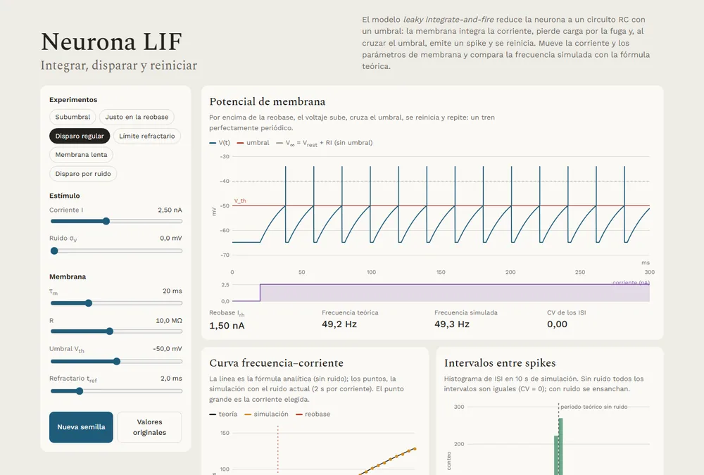
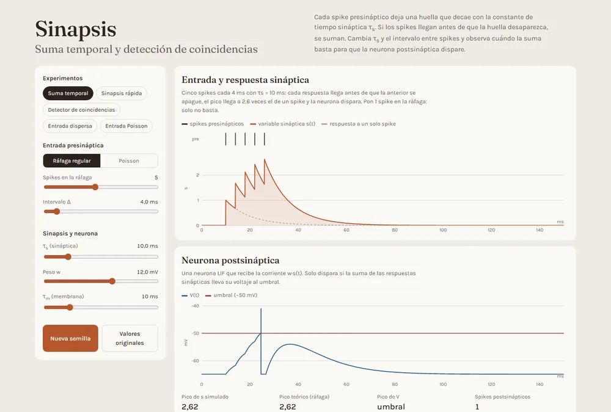
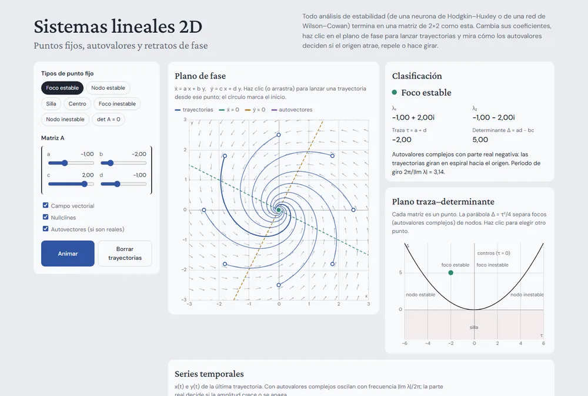
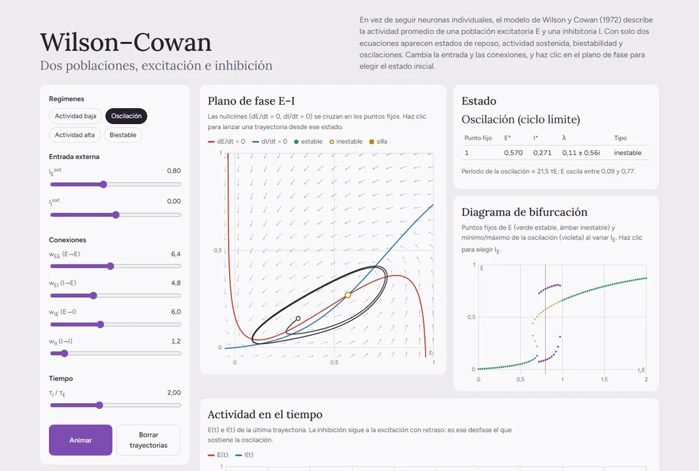
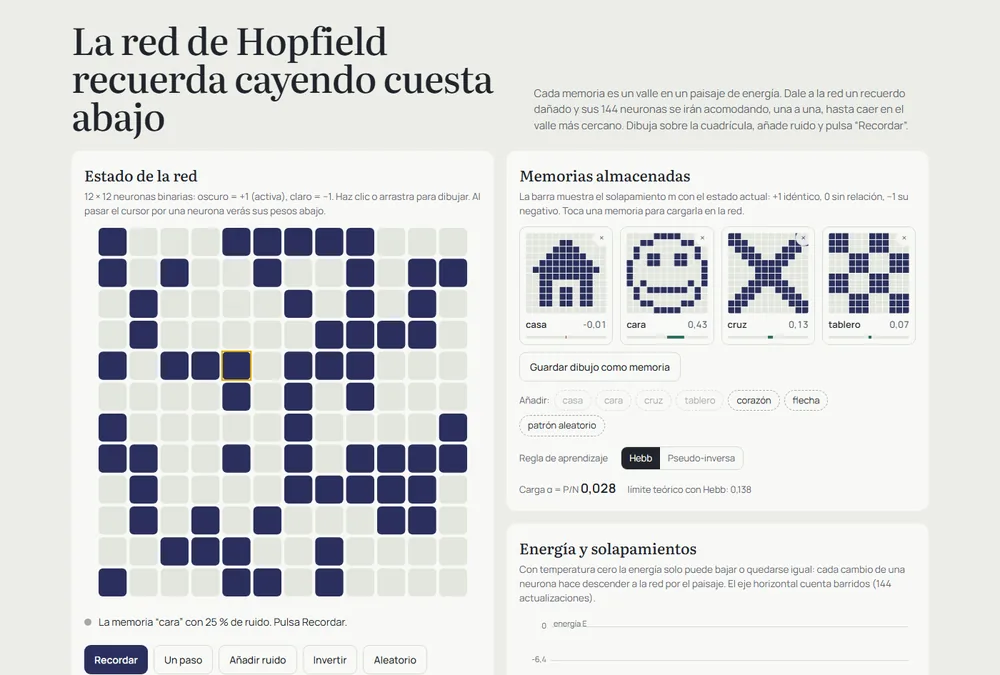
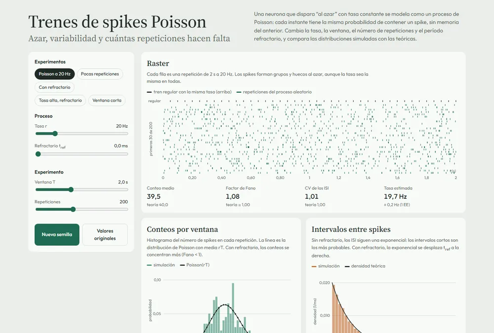
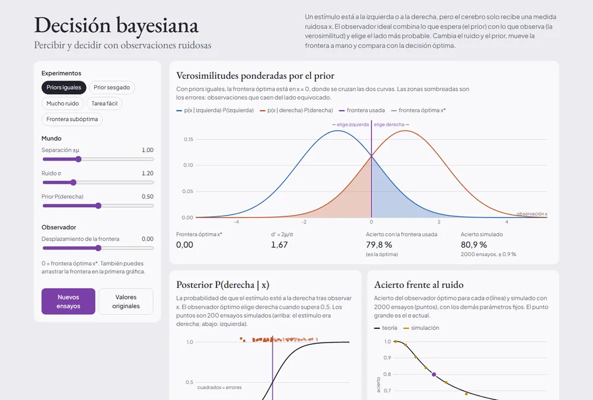

# Neurociencia computacional

[English](README.md) · **Español**

Un roadmap autodidacta y práctico para aprender neurociencia computacional. El objetivo es conectar la intuición biológica, los modelos matemáticos y los experimentos ejecutables: comprender un modelo, implementarlo o explorarlo y usar simulaciones para comprobar qué explica.

El proyecto incluye módulos interactivos en el navegador y un pequeño paquete Python con ejemplos ejecutables y pruebas. Sigue en desarrollo: la ruta es una propuesta de aprendizaje, no significa que todos los temas ya estén cubiertos.

## Ruta de aprendizaje

Ritmo sugerido: **18 semanas planificadas, de 5 a 8 horas semanales** (aprox. 90-144 horas). Es una estimación para autoestudio, no la duración oficial de un curso. La [ruta semana a semana](docs/ruta-de-aprendizaje.md) especifica objetivos, práctica y entregables.

| Semanas | Tema |
|---|---|
| 1-6 | Python y matemáticas, LIF, Hodgkin-Huxley, integración numérica, sinapsis y sistemas lineales |
| 7-11 | Sistemas dinámicos, modelos de población, Hopfield, procesos estocásticos y diseño experimental |
| 12-16 | Ajuste de modelos, GLM Poisson, codificación/decodificación, validación, PCA y procesamiento de señales |
| 17-18 | Especialización y proyecto final reproducible |

La [ruta autodidacta detallada](docs/ruta-de-aprendizaje.md) incluye actividades y un entregable para cada semana, checkpoints y recursos oficiales de Stanford y Neuromatch Academy.

## Qué está implementado

| Capa | Contenido |
|---|---|
| Paquete Python (`src/`) | LIF (con curva f-I analítica), Hodgkin-Huxley, Hopfield, ajuste lineal, GLM Poisson, PCA y la utilidad `current_pulse` |
| Semanas (`weeks/week_XX_<tema>/`) | Una carpeta por semana (1-18) con el script (teoría, ecuaciones, figura y validación con `assert`), su notebook ejecutado y sus `outputs/`; filtro sináptico, Wilson-Cowan, spikes Poisson, validación cruzada, procesamiento de señales y decisión bayesiana solo existen aquí |
| Módulos interactivos (`interactive/`) | Nueve módulos para el navegador: LIF, Hodgkin-Huxley, sinapsis, sistemas lineales 2D, Wilson-Cowan, Hopfield, trenes Poisson, decisión bayesiana y fNIRS con datos reales |
| Extensión opcional (`extensions/fnirs-cedalion/`) | Datos reales de fNIRS (*finger tapping*) analizados con [Cedalion](https://github.com/ibs-lab/cedalion): calidad de señal, corrección de movimiento, GLM con AR-IRLS y análisis de lateralización (validado con los puntos 10-20 de la cabeza). Entorno propio; ver su [README](extensions/fnirs-cedalion/README.md) |
| Aún no cubierto | Plasticidad sináptica/STDP, aprendizaje por refuerzo, datos experimentales de varios sujetos |

## Módulos actuales

**Pruébalos en línea:** [hiroforyou.github.io/computational-neuroscience/interactive/](https://hiroforyou.github.io/computational-neuroscience/interactive/). Todos los módulos corren en el navegador y se publican con GitHub Pages desde `interactive/`. El diseño se adapta a pantallas de teléfono (controles táctiles y tooltips al tocar).

| Módulo | Qué puedes explorar |
|---|---|
| [Neurona LIF: integrar, disparar y reiniciar](https://hiroforyou.github.io/computational-neuroscience/interactive/lif.html) | Cambiar la corriente, el ruido y los parámetros de membrana; comparar la curva f-I simulada con la analítica; ver la reobase, la saturación refractaria y el disparo irregular por ruido (histograma de ISI, CV) |
| [Hodgkin-Huxley: la neurona como sistema dinámico](https://hiroforyou.github.io/computational-neuroscience/interactive/hodgkin-huxley.html) | Ajustar el estímulo y las conductancias; explorar potenciales de acción, compuertas de canales, corrientes iónicas, espacio de fase y frecuencia de disparo |
| [Sinapsis: suma temporal y detección de coincidencias](https://hiroforyou.github.io/computational-neuroscience/interactive/sinapsis.html) | Variar las constantes de tiempo sináptica y de membrana, el intervalo de la ráfaga y el peso; comparar el pico simulado con la fórmula de la serie geométrica; ver cuándo la suma hace disparar a un LIF postsináptico |
| [Sistemas lineales 2D: puntos fijos y estabilidad](https://hiroforyou.github.io/computational-neuroscience/interactive/sistemas-lineales.html) | Editar una matriz 2×2 o hacer clic en el plano traza-determinante; lanzar trayectorias en el plano de fase; ver autovalores, autovectores, nullclines y la clasificación (foco, nodo, silla, centro) |
| [Wilson-Cowan: excitación, inhibición y oscilaciones](https://hiroforyou.github.io/computational-neuroscience/interactive/wilson-cowan.html) | Ajustar la entrada y las conexiones E/I; encontrar y clasificar puntos fijos en las nullclines; explorar actividad baja, oscilaciones de ciclo límite, biestabilidad y el diagrama de bifurcación |
| [Red de Hopfield: memoria como paisaje de energía](https://hiroforyou.github.io/computational-neuroscience/interactive/hopfield.html) | Guardar y recuperar patrones, añadir ruido e inspeccionar la energía, los solapamientos, los pesos sinápticos, las reglas de actualización y la capacidad de memoria |
| [Trenes de spikes Poisson: azar y variabilidad](https://hiroforyou.github.io/computational-neuroscience/interactive/poisson.html) | Cambiar la tasa, la ventana, las repeticiones y el refractario; comparar histogramas de conteos e ISI con la teoría; factor de Fano, CV y convergencia de la tasa estimada con más ensayos |
| [fNIRS con datos reales: tapping de dedos](https://hiroforyou.github.io/computational-neuroscience/interactive/fnirs.html) | Dataset abierto (Luke y McAlpine, 5 sujetos) procesado con Cedalion: elegir sujeto o grupo, contraste, cromóforo y umbral FDR; ver el mapa de activación, el índice de lateralización, la respuesta del GLM frente al promedio por bloques y la serie temporal |
| [Decisión bayesiana: percibir con ruido](https://hiroforyou.github.io/computational-neuroscience/interactive/decision-bayesiana.html) | Cambiar el ruido, la separación y el prior; arrastrar la frontera de decisión; ver las áreas de error, la posterior y el acierto simulado frente al teórico (Φ(d′/2)) |

### Capturas

Tema claro. La captura de fNIRS muestra la animación de la respuesta a mitad de recorrido. Haz clic en una imagen para abrir el módulo.

<table>
  <tr>
    <td width="50%" align="center">
      <a href="https://hiroforyou.github.io/computational-neuroscience/interactive/lif.html"></a><br>
      <sub><b>Neurona LIF</b></sub>
    </td>
    <td width="50%" align="center">
      <a href="https://hiroforyou.github.io/computational-neuroscience/interactive/hodgkin-huxley.html"></a><br>
      <sub><b>Hodgkin-Huxley</b></sub>
    </td>
  </tr>
  <tr>
    <td width="50%" align="center">
      <a href="https://hiroforyou.github.io/computational-neuroscience/interactive/sinapsis.html"></a><br>
      <sub><b>Sinapsis</b></sub>
    </td>
    <td width="50%" align="center">
      <a href="https://hiroforyou.github.io/computational-neuroscience/interactive/sistemas-lineales.html"></a><br>
      <sub><b>Sistemas lineales 2D</b></sub>
    </td>
  </tr>
  <tr>
    <td width="50%" align="center">
      <a href="https://hiroforyou.github.io/computational-neuroscience/interactive/wilson-cowan.html"></a><br>
      <sub><b>Wilson-Cowan</b></sub>
    </td>
    <td width="50%" align="center">
      <a href="https://hiroforyou.github.io/computational-neuroscience/interactive/hopfield.html"></a><br>
      <sub><b>Red de Hopfield</b></sub>
    </td>
  </tr>
  <tr>
    <td width="50%" align="center">
      <a href="https://hiroforyou.github.io/computational-neuroscience/interactive/poisson.html"></a><br>
      <sub><b>Trenes de spikes Poisson</b></sub>
    </td>
    <td width="50%" align="center">
      <a href="https://hiroforyou.github.io/computational-neuroscience/interactive/decision-bayesiana.html"></a><br>
      <sub><b>Decisión bayesiana</b></sub>
    </td>
  </tr>
  <tr>
    <td width="50%" align="center">
      <a href="https://hiroforyou.github.io/computational-neuroscience/interactive/fnirs.html"></a><br>
      <sub><b>fNIRS con datos reales</b></sub>
    </td>
    <td width="50%"></td>
  </tr>
</table>

## Cómo empezar

Los módulos interactivos no requieren instalación: usa la [versión en línea](https://hiroforyou.github.io/computational-neuroscience/interactive/) o abre cualquiera de los archivos HTML de `interactive/` en un navegador moderno.

Para ejecutar los experimentos Python (Python 3.10 o superior):

```powershell
py -3 -m venv .venv
.\.venv\Scripts\Activate.ps1
python -m pip install -e ".[dev]"
python -m pytest
python examples/run_models.py
```

`run_models.py` guarda las trazas de LIF y Hodgkin-Huxley en archivos NumPy `.npz`, dentro de la carpeta ignorada `outputs/`, e imprime los resultados de recuperación Hopfield y análisis básicos. Si no necesitas las pruebas, basta con instalar `.[examples]`.

Para ejecutar el script de cualquier semana del roadmap:

```powershell
python weeks/run_weekly.py --list
python weeks/run_weekly.py 1
```

Cada semana guarda figuras/datos/informe en su propia carpeta `weeks/week_XX_<tema>/outputs/`, ignorada por Git (con la variable `COMPUTATIONAL_NEUROSCIENCE_OUTPUT_DIR` se pueden escribir en otro lugar). La [ruta semana a semana](docs/ruta-de-aprendizaje.md) relaciona cada script con su objetivo de aprendizaje.

### Notebooks

Cada carpeta de semana contiene el script y su notebook, uno al lado del otro:

```text
weeks/week_03_lif_currents/
├── week_03_lif_currents.py      # fuente: se edita aquí
├── week_03_lif_currents.ipynb   # generado y ejecutado (teoría, ecuaciones, figuras)
└── outputs/                     # .png, .npz, informes (ignorado por Git)
```

Abre el notebook (VS Code, JupyterLab o GitHub) para leer la teoría y ver las figuras sin ejecutar nada. El notebook se genera desde las celdas `# %%` del script:

```powershell
python tools/convert_to_notebooks.py --execute            # regenera los 18, con figuras
python tools/convert_to_notebooks.py --reuse-outputs      # solo cambió texto: conserva las figuras sin ejecutar
python tools/convert_from_notebooks.py weeks/week_03_lif_currents/week_03_lif_currents.ipynb   # lleva cambios del notebook al script
```

Edita el script (o el notebook y conviértelo de vuelta) y regenera. Un test falla si algún notebook queda desactualizado.

## Método de estudio

1. Lee la explicación del modelo e identifica sus supuestos.
2. Predice cómo cambiará el sistema al modificar un parámetro.
3. Ejecuta el experimento y compara el resultado con tu predicción.
4. Explica el resultado con tus propias palabras y anota qué aspectos no representa el modelo.
5. Conserva el código, los parámetros, las unidades y las limitaciones para poder reproducir el resultado.

## Estructura del proyecto

```text
computational-neuroscience/
├── interactive/                     # Módulos para el navegador (sin instalación)
│   ├── index.html                   # Página de inicio para GitHub Pages
│   ├── lif.html                     # Semana 3: neurona LIF y curva f-I
│   ├── hodgkin-huxley.html          # Semanas 4-5
│   ├── sinapsis.html                # Semana 6: suma temporal
│   ├── sistemas-lineales.html       # Semana 7: puntos fijos y estabilidad
│   ├── wilson-cowan.html            # Semana 8: poblaciones E-I
│   ├── hopfield.html                # Semana 9
│   ├── poisson.html                 # Semana 10: variabilidad de trenes de spikes
│   ├── decision-bayesiana.html      # Semana 17: decisión bayesiana
│   ├── fnirs.html                   # Semana 17 (opción datos): fNIRS real
│   └── data/                        # Datos de fnirs.html (generados por la extensión de Cedalion)
├── src/computational_neuroscience/  # Paquete Python
│   ├── lif.py                       # Leaky integrate-and-fire y curva f-I analítica
│   ├── hodgkin_huxley.py            # Hodgkin-Huxley (Euler explícito)
│   ├── hopfield.py                  # Entrenamiento Hebbiano y recuperación asíncrona
│   ├── analysis.py                  # Ajuste lineal, GLM Poisson, PCA
│   ├── outputs.py                   # Guarda figuras/datos para scripts y notebooks (matplotlib)
│   └── _validation.py               # Rejillas temporales, corrientes, current_pulse
├── examples/
│   └── run_models.py                # Experimentos iniciales con todos los modelos
├── weeks/
│   ├── run_weekly.py                # Lanzador: python weeks/run_weekly.py <semana>
│   ├── week_01_python_reproducibility/  # script .py + notebook .ipynb + outputs/
│   ├── …
│   └── week_18_capstone/
├── extensions/fnirs-cedalion/       # Opcional: datos reales de fNIRS con Cedalion (entorno propio)
│   ├── fnirs_finger_tapping.py      # Fuente del notebook de análisis (.ipynb a su lado)
│   └── export_luke_demo.py          # Genera interactive/data/ para fnirs.html
├── tools/                           # convert_to_notebooks.py / convert_from_notebooks.py
├── tests/
│   ├── test_models.py               # Comportamiento numérico y validación de entradas
│   └── test_weekly_scripts.py       # Cada script corre y valida; notebooks sincronizados
├── docs/
│   ├── ruta-de-aprendizaje.md       # Ruta semana a semana y enlaces a cursos
│   └── images/                      # Capturas de los módulos interactivos para el README
├── .github/workflows/pages.yml      # Publica interactive/ en GitHub Pages
├── pyproject.toml
├── LICENSE                          # MIT (excluye datos de terceros)
├── README.md / README.es.md
└── .gitignore
```

## Idioma

Los módulos interactivos y el roadmap detallado están en español. Este README está disponible en [inglés](README.md) y español.

## Alcance

Este es un proyecto de estudio autodidacta, no un curso formal ni un sustituto de la literatura primaria. Los modelos son representaciones simplificadas de sistemas biológicos; sus resultados deben interpretarse teniendo en cuenta los supuestos de cada modelo. El material de fNIRS es educativo y no está pensado para uso clínico ni diagnóstico.

## Licencia

El código, la documentación, los notebooks y los módulos interactivos se publican bajo la [licencia MIT](LICENSE). El material de terceros de la tabla siguiente conserva sus propias condiciones.

## Datos y créditos

| Recurso | Uso en este repositorio | Condiciones |
|---|---|---|
| *fNIRS Finger Tapping Data in BIDS Format*, R. Luke y D. McAlpine, [doi:10.5281/zenodo.5529797](https://doi.org/10.5281/zenodo.5529797) | Resultados procesados en `interactive/data/` para el módulo de fNIRS | Acceso abierto en Zenodo (other-open); citar el DOI |
| [Cedalion](https://github.com/ibs-lab/cedalion) v26.5.1, The Cedalion Developers | Biblioteca de análisis; el notebook de fNIRS adapta los tutoriales 3 y 4 | Licencia MIT |
| Dataset HD-DOT de *finger tapping*, IBS Lab (`cedalion.data.get_fingertappingDOT`) | Lo descarga el notebook de fNIRS al ejecutarse; no se redistribuye | Solo para notebooks de ejemplo de Cedalion |
| [Neuromatch Academy](https://compneuro.neuromatch.io/) y páginas de cursos de Stanford | Enlazados desde la ruta; no se copia contenido | Condiciones de sus titulares |

Referencia de los métodos de fNIRS: Middell, E. et al. (2026). Cedalion tutorial. *Neurophotonics* 13(S3), S32602. [doi:10.1117/1.NPh.13.S3.S32602](https://doi.org/10.1117/1.NPh.13.S3.S32602)
